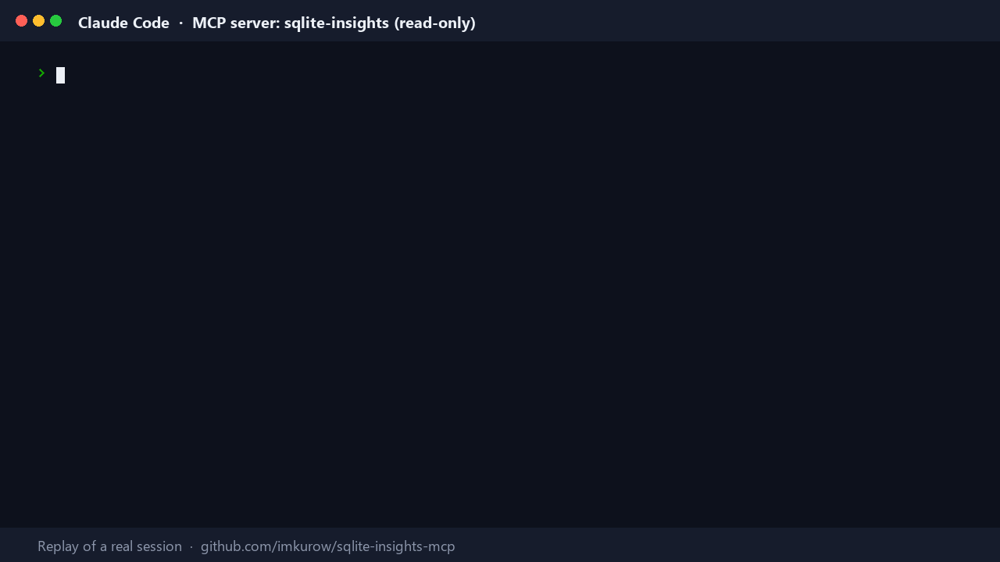

# SQLite Insights MCP Server

Ask Claude business questions in plain English and get answers straight from your SQLite database, without giving it the ability to change a single row.

> "Who were our top 5 customers by revenue last quarter?"
> "Which invoices are overdue, and how much is outstanding per country?"
> "What's our best-selling product category this year?"

Claude explores the schema, writes the SQL, runs it through this server and explains the result. Your data stays read-only the whole time.



*The demo replays a real Claude Code session with this server: the tool calls, SQL, results and error message were captured from the live server against the sample database. [MP4 version](docs/demo.mp4).*

## What it does

This is a [Model Context Protocol](https://modelcontextprotocol.io) (MCP) server. MCP is the open standard Claude, Cursor and other AI tools use to talk to real systems. This server exposes one SQLite database through:

| Tool | Purpose |
|---|---|
| `list_tables` | Every table with its row count |
| `describe_table` | Columns, types, foreign keys and 3 sample rows |
| `run_query` | Run one `SELECT` query, up to 1,000 rows (default 200) |

Plus one resource, `schema://database`, with the full `CREATE` statements.

All three tools carry the MCP `readOnlyHint` annotation, so clients know they never modify anything.

## Why read-only matters

Letting an AI write SQL against business data is useful. Letting it run `DELETE` or `DROP TABLE` by mistake is not. Instead of trusting a "SELECT only" regex, the protection is enforced by SQLite itself, in two independent layers:

1. **Read-only file handle.** The database is opened with `mode=ro`, so the connection physically cannot write.
2. **SQL authorizer.** Every statement is checked while SQLite compiles it. Only reads are allowed. `INSERT`, `UPDATE`, `DELETE`, `CREATE`, `DROP`, `ALTER`, `ATTACH`, transactions and settings `PRAGMA`s are refused before they run.

On top of that:

- **One statement per call**, so nothing can be smuggled in after a `;`.
- **Row cap** of 1,000 rows, with a `truncated` flag so Claude knows when it's seeing a partial result.
- **5-second time limit**, so a runaway query is stopped instead of hanging.
- **Clear error messages** the model can act on, for example: *"Blocked: this server is read-only, and the statement tried to perform DELETE on invoices. Only SELECT queries are allowed."*

## Setup

Requires Python 3.10+.

```bash
git clone https://github.com/imkurow/sqlite-insights-mcp.git
cd sqlite-insights-mcp
python -m venv .venv
.venv\Scripts\activate          # macOS/Linux: source .venv/bin/activate
pip install -r requirements.txt
python seed.py                  # creates data/sample.db
```

`seed.py` builds a realistic sample sales database: 40 customers, 20 products, about 170 orders with line items, and invoices that are paid, unpaid or overdue. Dates are relative to today, so "last quarter" always has data.

### Use your own database

Point the server at any SQLite file with the `SQLITE_INSIGHTS_DB` environment variable. It is opened read-only.

## Connect it to Claude

### Claude Code

Windows example, assuming the project lives in `C:\Projects\sqlite-insights-mcp`:

```powershell
claude mcp add sqlite-insights -- "C:\Projects\sqlite-insights-mcp\.venv\Scripts\python.exe" "C:\Projects\sqlite-insights-mcp\server.py"
```

With your own database:

```powershell
claude mcp add sqlite-insights --env SQLITE_INSIGHTS_DB="C:\data\shop.db" -- "C:\Projects\sqlite-insights-mcp\.venv\Scripts\python.exe" "C:\Projects\sqlite-insights-mcp\server.py"
```

macOS/Linux:

```bash
claude mcp add sqlite-insights -- "$PWD/.venv/bin/python" "$PWD/server.py"
```

Check it with `claude mcp get sqlite-insights`, then ask a question in Claude Code.

### Claude Desktop

Edit `claude_desktop_config.json`. On Windows it's at `%APPDATA%\Claude\claude_desktop_config.json`, and on macOS at `~/Library/Application Support/Claude/claude_desktop_config.json`.

```json
{
  "mcpServers": {
    "sqlite-insights": {
      "command": "C:\\Projects\\sqlite-insights-mcp\\.venv\\Scripts\\python.exe",
      "args": ["C:\\Projects\\sqlite-insights-mcp\\server.py"],
      "env": {
        "SQLITE_INSIGHTS_DB": "C:\\Projects\\sqlite-insights-mcp\\data\\sample.db"
      }
    }
  }
}
```

Restart Claude Desktop. The tools appear under the tools menu.

## Example prompts

- *"What tables do we have, and how are they related?"*
- *"Top 5 customers by revenue last quarter, with their country and segment."*
- *"List overdue invoices, oldest first, and the total amount outstanding."*
- *"Monthly revenue for the last 12 months. Which month was best?"*
- *"Which product category brings in the most revenue from Enterprise customers?"*
- *"Delete all cancelled orders."* Claude is refused, and tells you the server is read-only.

## Development

```bash
pip install pytest
python -m pytest                 # unit + in-process MCP tests
python scripts/smoke_test.py     # launches the server over stdio, like Claude does, and calls every tool
```

The test suite checks that every tool returns correct data against a direct SQLite query, and that `INSERT`, `UPDATE`, `DELETE`, `REPLACE`, `DROP`, `CREATE`, `ALTER`, `ATTACH`, `BEGIN` and write `PRAGMA`s are all refused with the database left unchanged.

## Project layout

```
server.py              MCP server: tools, resource, server instructions for Claude
db.py                  Read-only database layer (mode=ro + authorizer, limits, error mapping)
seed.py                Sample sales database generator
tests/                 pytest suite
scripts/smoke_test.py  End-to-end stdio check
```

## Need something like this for your data?

I build MCP servers and AI-agent integrations that connect Claude to real business systems (databases, APIs, SaaS tools), safely. Reach me on Upwork: **Thierry "Zack" L.**

## License

MIT © 2026 Thierry "Zack" L.
